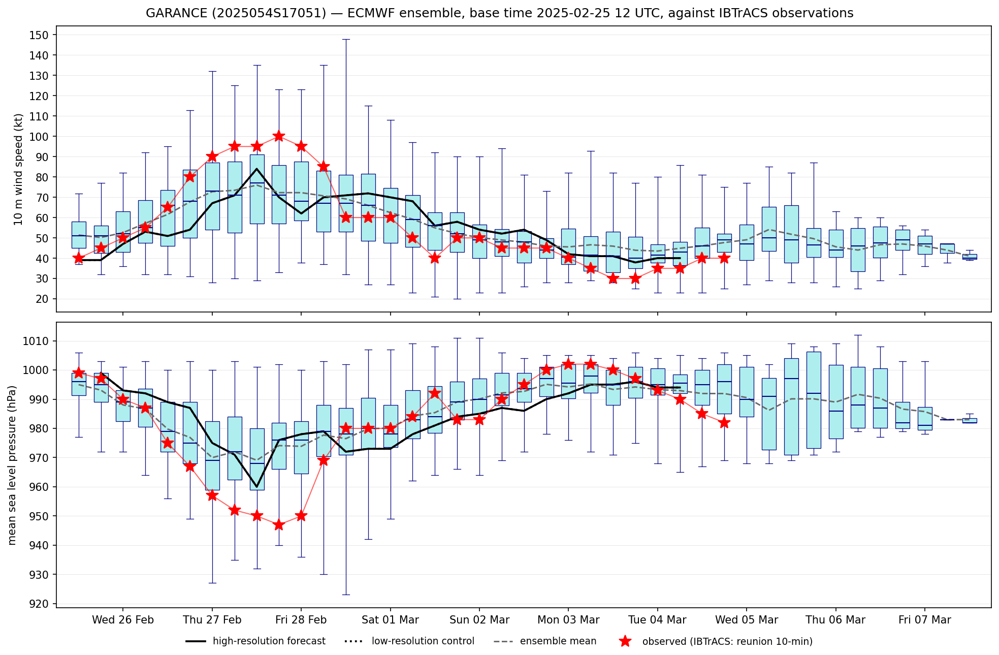
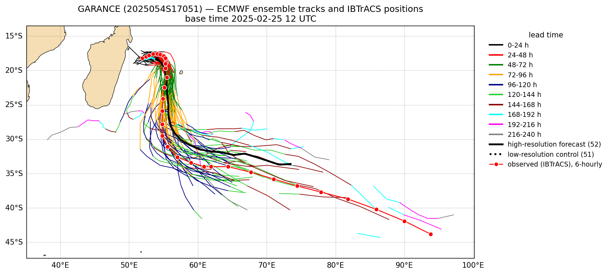

# trackver

Compares an ECMWF ensemble tropical cyclone forecast with what was observed.

For a storm you name, `trackver` downloads the latest [IBTrACS](https://www.ncei.noaa.gov/products/international-best-track-archive)
best-track observations and lists the ECMWF ensemble runs that started while the storm was
observed. You pick one, and it makes two plots of that run.

**Meteogram:** the ensemble's maximum 10 m wind and central pressure at every 6-hour step, with
the observed value for each step on top.



**Plume map:** every member's track, coloured by lead time in 24-hour bands, with the
high-resolution forecast and the control in black. The red dots are the observed storm
positions at the forecast steps.



## Installation

```
git clone https://github.com/alinalerneral/trackver.git
cd trackver
conda env create -f environment.yml      # or mamba / micromamba
conda activate trackver
```

Without conda, `pip install -r requirements.txt` works too, as long as `wget` is installed.

## Usage

```
./trackver GARANCE            # storm name, any case
```
OR
```
./trackver 2025054S17051      # the IBTrACS storm id (SID)
```

```
The storm was observed from 2025-02-23 06 to 2025-03-04 18 UTC; first landfall 2025-02-28 06 UTC.
Forecast runs available:

   #  base time (UTC)   range   observed up to   steps with obs   landfall at
   ...
  10  2025-02-25 12     240 h   T+174 h            30            T+66 h
  11  2025-02-25 18     144 h   T+144 h            25            T+60 h
   ...

Which run (number)? 10
```

The plots are saved in `plots/`, inside the repository folder, and then shown on screen. If there is
no display, they are only saved. `<DTG>` is the run's base time, `YYYYMMDDHH`:

```
plots/ver_meteogram_<STORMNAME>_<DTG>.png      e.g. plots/ver_meteogram_GARANCE_2025022512.png
plots/ver_plumes_<STORMNAME>_<DTG>.png         e.g. plots/ver_plumes_GARANCE_2025022512.png
```

| option | meaning |
| --- | --- |
| `--max-hours N` | last forecast step to plot (default 240) |
| `--outdir DIR` | where to save the plots (default: `plots/`) |
| `--no-show` | save the plots without showing them |

## Notebook

`trackver.ipynb` goes through the same steps one cell at a time and shows the two plots in the
notebook instead of saving them. Set the storm and the run in its first code cell, then run all cells:

```
jupyter lab trackver.ipynb
```

```python
STORM = "GARANCE"       # if the name was reused, the storm observed at RUN is used
RUN = "2025022512"      # base time of the run, YYYYMMDDHH
```

The notebook loads the `trackver` program as a module, so the command and the notebook always
behave the same way.